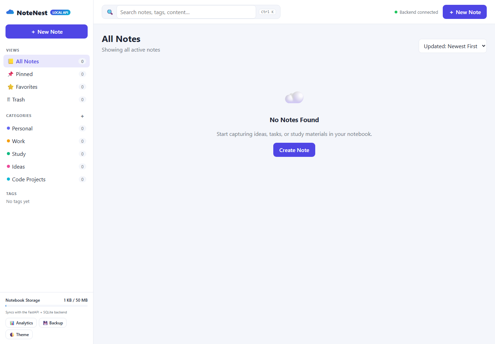
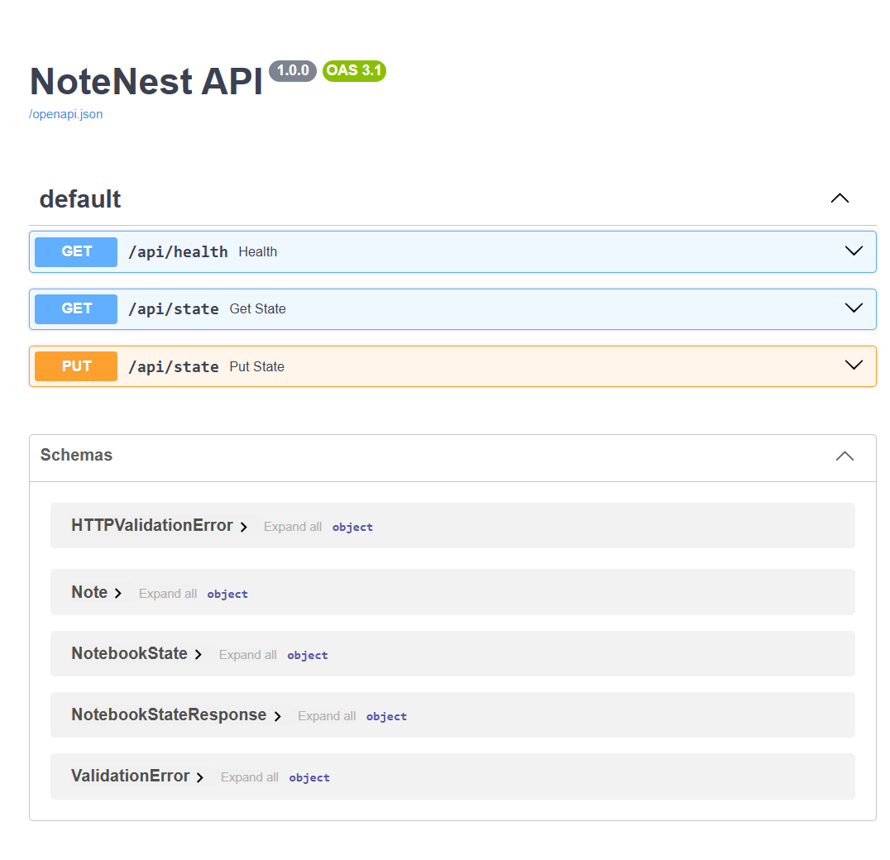

# NoteNest

NoteNest is a lightweight notes app with a responsive browser interface and a local FastAPI + SQLite backend. Create and organize notes with categories, tags, Markdown preview, favorites, pinning, and trash. Notes are cached in the browser and synchronized to SQLite when the backend is available.

## Screenshots

### Notes dashboard



### REST API documentation



## Requirements

- Python 3.10 or newer
- pip

## Run on Windows

From the project directory:

```powershell
cd backend
python -m venv .venv
.\.venv\Scripts\Activate.ps1
python -m pip install -r requirements.txt
python -m uvicorn main:app --reload --host 127.0.0.1 --port 8000
```

Open [http://127.0.0.1:8000](http://127.0.0.1:8000) for the app. Interactive REST API documentation is at [http://127.0.0.1:8000/docs](http://127.0.0.1:8000/docs).

## Storage and offline use

The backend stores notes, categories, and theme preferences in `backend\cloudnotes.sqlite3`. Set `CLOUDNOTES_DB_PATH` to choose another database file. The first successful connection imports existing browser-cached data when the database has not been initialized. While the backend is unavailable, the browser keeps changes locally and syncs them when it reconnects.

This is a local backend, not a deployed cloud service. It does not include user accounts, authentication, or remote hosting.
